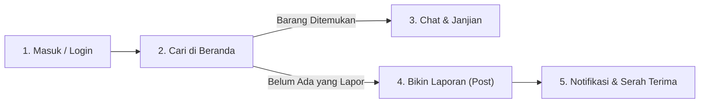

# 🔍 Lost & Found Web Application (`lost-found-app`)

Aplikasi web modern berbasis **React 19** dan **Vite** yang dirancang untuk mempermudah pelaporan, pencarian, dan pengembalian barang hilang atau ditemukan di lingkungan kampus maupun publik. Dilengkapi dengan sistem autentikasi, feed interaktif, formulir laporan lengkap, obrolan langsung (*messenger* kontak penemu/pemilik), dan pengaturan profil pengguna.

---

## 🌟 Fitur Utama (Core Features)

### 1. 🔐 Autentikasi & Akun Pengguna
- **Login & Signup**: Antarmuka masuk dan pendaftaran akun yang responsif dan terintegrasi dengan state aplikasi serta validasi sesi pengguna.
- **Nama Pengguna Dinamis**: Nama pengguna yang diinput saat login akan otomatis tersinkronisasi di Dashboard, Header, Profil, dan Komentar.
- **Profil Pengguna (`/dashboard/account`)**: Menampilkan identitas pengguna, foto profil, dan status akun aktif.
- **Pengaturan Akun (`/dashboard/setting`)**: Formulir untuk memperbarui nama tampilan dan mengelola preferensi notifikasi (barang & pesan).

### 2. 🏠 Beranda & Feed Postingan (`/dashboard`)
- **Feed Interaktif**: Menampilkan daftar barang hilang dan ditemukan dengan foto, nama pelapor, deskripsi, lokasi, dan status badge (*Lost / Found*).
- **Filter Cepat (Status Tabs)**: Filter satu klik untuk memilah postingan:
  - 🌐 **Semua Postingan**
  - 🔍 **Barang Hilang (Lost)**
  - 📦 **Barang Temuan (Found)**
- **Pencarian Real-Time (Live Search)**: Filter instan berdasarkan kata kunci nama barang, kategori, lokasi, atau isi deskripsi.
- **Pelaporan Postingan**: Fitur tanda lapor (*flag / report count*) untuk menandai postingan yang mencurigakan atau spam.
- **Tombol Hubungi Langsung (Direct Chat Trigger)**: Setiap kartu barang dilengkapi tombol chat yang langsung membuka room percakapan privat dengan pelapor barang tersebut.

### 3. 📝 Formulir Laporan Barang Baru (`/dashboard/post`)
- **Selector Jenis Laporan**: Pilihan tipe laporan satu klik:
  - 🔍 **Saya Kehilangan Barang (Lost)**
  - 📦 **Saya Menemukan Barang (Found)**
- **Input Data Komprehensif**:
  - Nama / Judul Barang
  - Kategori Barang (Dompet/Tas, Elektronik & Gadget, Kunci & Aksesoris, Dokumen/Kartu, Pakaian, Lainnya)
  - Lokasi Kejadian / Ditemukan
  - Tanggal Kejadian (Date Picker)
  - Kontak WhatsApp / No. HP
  - Deskripsi detail & ciri-ciri khusus
- **Upload & Preview Foto**: Area unggah gambar interaktif (*dropzone*) dengan live preview dan tombol hapus/ganti foto.
- **Sinkronisasi Otomatis**: Data baru otomatis tersimpan dan langsung tampil di feed Beranda secara instan.

### 4. 💬 Sistem Pesan / Messenger Kontak Penemu (`/dashboard/chat`)
- **Tampilan 2 Kolom Modern (WhatsApp/Messenger Style)**:
  - **Panel Kiri (Daftar Percakapan)**: Menampilkan kontak yang sedang aktif, status online/offline, badge barang yang sedang dibahas, cuplikan pesan terakhir, dan fitur pencarian obrolan.
  - **Panel Kanan (Jendela Chat Aktif)**: Riwayat pesan lengkap dengan bubble chat masuk (kiri) dan keluar (kanan bertema biru), penunjuk waktu, dan banner konteks barang yang dibicarakan.
- **Direct Query URL Sync**: Saat tombol chat di beranda diklik, aplikasi membuka URL parameter `?to=<nama>&item=<barang>` dan secara otomatis menginisiasi ruang obrolan untuk barang terkait.
- **Quick Action Chips & Bot Response**: Fitur balasan cepat dan simulasi respon penemu barang.
- **Penyimpanan Lokal**: Pesan obrolan tersimpan aman di browser pengguna.

### 5. 🚫 Halaman 404 Responsif (`/src/Pages/NotFound.jsx`)
- Halaman penanganan rute tidak ditemukan yang modern, rapi, dan dilengkapi navigasi kembali ke Beranda.

---

## 🛠️ Tech Stack & Dependensi

| Layer / Kebutuhan | Teknologi yang Digunakan |
|:---|:---|
| **Framework & Library** | [React 19](https://react.dev/), [React DOM 19](https://react.dev/) |
| **Build Tool & Bundler** | [Vite 8](https://vitejs.dev/) |
| **Routing** | [React Router DOM v7](https://reactrouter.com/) |
| **UI Icons & Helpers** | [@mui/material](https://mui.com/), [@mui/icons-material](https://mui.com/) |
| **Styling** | Pure Modern CSS, CSS Grid, Flexbox, CSS Custom Properties / Variables |
| **Penyimpanan Data Sementara** | In-Memory State & Browser `localStorage` |

---

## 📂 Struktur Direktori Proyek

```text
Lost-and-Found-APP/
├── public/
├── src/
│   ├── assets/               # Berkas gambar, icon, dan avatar pengguna
│   ├── auth/                 # Autentikasi & sesi pengguna (authStore.jsx)
│   ├── components/           # Komponen layout & elemen antarmuka
│   │   ├── AccountDetails.jsx# Detail informasi profil
│   │   ├── Dashboard.jsx     # Master layout container (Header, Sidebar, Content, Footer)
│   │   ├── Header.jsx        # Topbar judul, status profil, dan menu toggle
│   │   ├── LampScene.jsx     # Animasi pendukung UI
│   │   ├── LogoutNotice.jsx  # Notifikasi dialog log out
│   │   ├── Report.jsx        # Komponen pelaporan item
│   │   ├── RequireAuth.jsx   # Route guard autentikasi
│   │   ├── Search.jsx        # Komponen search bar
│   │   ├── Sidebar.jsx       # Navigasi utama (Beranda, Post, Chat, Setting, Sign Out)
│   │   ├── UserAvatar.jsx    # Avatar profil pengguna
│   │   └── Footer.jsx        # Footer copyright & info aplikasi
│   ├── data.jsx/             # Mock data feed & template balasan chat otomatis
│   ├── Pages/                # Halaman aplikasi
│   │   ├── Login.jsx         # Halaman autentikasi login
│   │   ├── Signup.jsx        # Halaman registrasi akun
│   │   ├── Home.jsx          # Halaman beranda, feed postingan, filter status, & search bar
│   │   ├── Post.jsx          # Halaman formulir lapor barang hilang/ditemukan
│   │   ├── Chat.jsx          # Halaman ruang obrolan kontak penemu/pemilik
│   │   ├── Account.jsx       # Halaman ringkasan profil pengguna
│   │   ├── Setting.jsx       # Halaman pengaturan profil & preferensi
│   │   └── NotFound.jsx      # Halaman error 404 (Route fallback)
│   ├── style/                # Lembar gaya CSS terstruktur & responsive
│   ├── App.jsx               # Konfigurasi routing & parent state
│   ├── main.jsx              # Entry point React
│   └── index.css             # Base reset & font styling
├── package.json              # Daftar dependensi & npm scripts
├── vite.config.js            # Konfigurasi bundler Vite
└── README.md                 # Dokumentasi proyek
```

---

## 🚀 Panduan Menjalankan Proyek (Getting Started)

### 1. Prasyarat Sistem
- **Node.js** (versi 18 ke atas disarankan)
- **npm** atau **pnpm / yarn**

### 2. Instalasi Dependensi
Buka terminal di root direktori proyek, lalu jalankan:
```bash
npm install
```

### 3. Menjalankan Server Pengembangan (Dev Mode)
Jalankan perintah berikut:
```bash
npm run dev
```
Setelah server menyala, buka URL lokal yang tertera di terminal (biasanya `http://localhost:5173/`).

### 4. Build untuk Lingkungan Produksi (Production Build)
Untuk menguji hasil kompilasi akhir:
```bash
npm run build
npm run preview
```

---

## 📖 Panduan Penggunaan Lengkap (Tutorial End-to-End untuk Pengguna Awam)

Panduan praktis langkah demi langkah bagi siapa saja (mahasiswa, staf, atau umum) yang ingin menggunakan aplikasi ini untuk mencari barang yang hilang atau mengembalikan barang temuan.



### Skenario A: "Saya Kehilangan Barang" (Dompet, Kunci, HP, Laptop, dsb.)

#### Langkah 1: Masuk ke Akun Anda
1. Buka aplikasi di browser Anda.
2. Di layar **Login**, masukkan nama Anda pada kolom **Username** (contoh: `Budi` atau `Siti`) dan masukkan Password Anda.
3. Klik tombol biru **"Login"**. Anda akan langsung dibawa ke halaman utama (Beranda).

#### Langkah 2: Cari Tahu Apakah Barang Anda Sudah Ditemukan Orang Lain
1. Di halaman **Beranda**, gunakan tab filter cepat (misal klik tab merah **"🔍 Hilang (Lost)"**).
2. Perhatikan kolom pencarian di bagian atas: *"Cari deskripsi atau nama barang..."*.
3. Ketik kata kunci barang Anda, misalnya: `dompet`, `kunci`, atau nama lokasi seperti `kantin`.
4. Tekan **Enter** atau klik tombol **"Cari"**.
5. Periksa kartu postingan yang muncul:
   - Jika foto dan deskripsinya cocok dengan barang Anda yang hilang, klik tombol chat di postingan tersebut.
   - Anda akan otomatis dialihkan ke ruang obrolan langsung dengan orang yang menemukan barang Anda!

#### Langkah 3: Berkomunikasi via Chat & Janjian Pengambilan
1. Di halaman obrolan, Anda bisa langsung mengetik pesan, misalnya:
   > *"Halo kak, itu dompet saya yang hilang tadi siang. Di dalamnya ada KTP atas nama Budi."*
2. Anda juga bisa menekan tombol cepat (*quick chips*) di atas kolom ketik, seperti:
   - `👋 Masih ada?`
   - `📍 Janjian di Pos Satpam`
   - `📄 Bukti Kepemilikan`
3. Sepakati waktu dan tempat bertemu yang aman untuk mengambil barang Anda.

#### Langkah 4: Jika Belum Ada yang Menemukan (Buat Laporan Kehilangan)
1. Klik menu **"Post"** di menu sebelah kiri layar.
2. Pastikan tombol merah **"🔍 Saya Kehilangan Barang (Lost)"** dalam keadaan terpilih.
3. Isi informasi selengkap mungkin:
   - **Nama Barang**: contoh *"Kunci Motor Vario Gantungan Boneka Hitam"*.
   - **Kategori**: Pilih kategori yang sesuai (misal: *Kunci & Aksesoris*).
   - **Lokasi Terakhir**: Tulis tempat terakhir Anda mengingatnya (misal: *Perpustakaan Lantai 2*).
   - **Tanggal Kejadian**: Pilih tanggal saat barang hilang.
   - **Foto Barang**: Klik kotak upload foto jika Anda punya foto barang tersebut sebelumnya.
   - **Deskripsi Detail**: Tuliskan ciri-ciri khusus (ada goresan, stiker, warna gantungan, dsb.).
   - **Nomor Kontak/WA**: Masukkan nomor HP aktif Anda agar penemu bisa menghubungi.
4. Klik tombol biru **"🚀 Terbitkan Laporan Sekarang"**.
5. Laporan Anda langsung tayang di Beranda dan bisa dilihat oleh semua pengguna!

---

### Skenario B: "Saya Menemukan Barang Milik Orang Lain"

#### Langkah 1: Terbitkan Laporan Penemuan Barang
1. Masuk ke aplikasi, lalu klik menu **"Post"** di sebelah kiri.
2. Klik tombol hijau **"📦 Saya Menemukan Barang (Found)"**.
3. Isi formulir penemuan:
   - **Nama Barang**: contoh *"Tumbler Minum Stainless Warna Abu-Abu"*.
   - **Kategori**: Pilih kategori barang.
   - **Lokasi Ditemukan**: Tulis lokasi persisnya (misal: *Meja Gazebo Depan Gedung A*).
   - **Foto Barang**: Ambil foto barang temuan menggunakan kamera HP/laptop lalu upload di kotak foto.
   - **Deskripsi**: Tulis kondisi barang dan tempat barang tersebut sekarang diamankan (misal: *"Barang saat ini saya titipkan di petugas piket lobi"*).
4. Klik **"🚀 Terbitkan Laporan Sekarang"**.

#### Langkah 2: Menunggu Pemilik Menghubungi Anda
1. Pemilik barang yang melihat postingan Anda akan menghubungi Anda via fitur obrolan.
2. Anda bisa memantau pesan masuk melalui menu **"Chat"** di sebelah kiri layar.
3. Cocokkan bukti kepemilikan sebelum menyerahkan barang (minta pemilik menyebutkan ciri khusus atau isi barang yang tidak Anda sebutkan di deskripsi umum demi keamanan).

---

### Skenario C: Mengelola Profil & Pengaturan

1. **Melihat Profil**: Klik menu **Account** di sidebar atau klik foto profil Anda di pojok kiri bawah untuk melihat status akun Anda.
2. **Mengubah Nama Tampilan**:
   - Klik menu **"Pengaturan"** (*Setting*).
   - Ubah nama Anda pada kolom **Nama**.
   - Atur centang notifikasi jika ingin menerima pemberitahuan barang baru atau pesan obrolan.
   - Klik **"Simpan Perubahan"**.

---

## 💡 Panduan Pengujian Fitur (Testing Flow)

1. **Alur Masuk (Login)**:
   - Di halaman login, masukkan nama pengguna (contoh: `Nicholas` atau `Pengguna1`) dan password sembarang.
   - Klik **Login** untuk masuk ke Dashboard.
2. **Mencari & Menghubungi Penemu Barang**:
   - Di Beranda, gunakan tombol tab filter (Semua, Lost, Found) atau gunakan kotak pencarian.
   - Klik tombol obrolan pada postingan tersebut.
   - Anda akan diarahkan langsung ke halaman Chat dengan ruang percakapan yang sudah terhubung ke pemilik barang.
3. **Menerbitkan Laporan Barang**:
   - Buka menu **Post** di bilah sisi kiri.
   - Pilih tab status (*Lost* atau *Found*).
   - Isi nama barang, pilih kategori, tentukan lokasi, dan unggah foto bukti.
   - Klik **"🚀 Terbitkan Laporan Sekarang"**. Laporan Anda akan langsung tampil di urutan teratas feed Beranda.

---

## 🎨 Standar Desain & Palet Warna

- **Primary Color**: `#64B5F6` (Sky Blue)
- **Primary Dark**: `#42A5F5` / `#1E88E5`
- **Primary Soft / Surface**: `#EAF5FE` / `#F0F9FF`
- **Background Utama**: `#F4F7FA`
- **Status Lost / Urgent**: `#EF4444` (Soft Red `#FEF2F2`)
- **Status Found / Resolved**: `#10B981` (Soft Green `#ECFDF5`)
- **Font & Tipografi**: Modern Sans-Serif, Line-height longgar, Card Shadow lembut (`0 4px 20px rgba(0,0,0,0.05)`).

---

## 👨💻 Kontributor & Lisensi

- Dikembangkan untuk proyek **Lost & Found App**
- Lisensi: **MIT License**